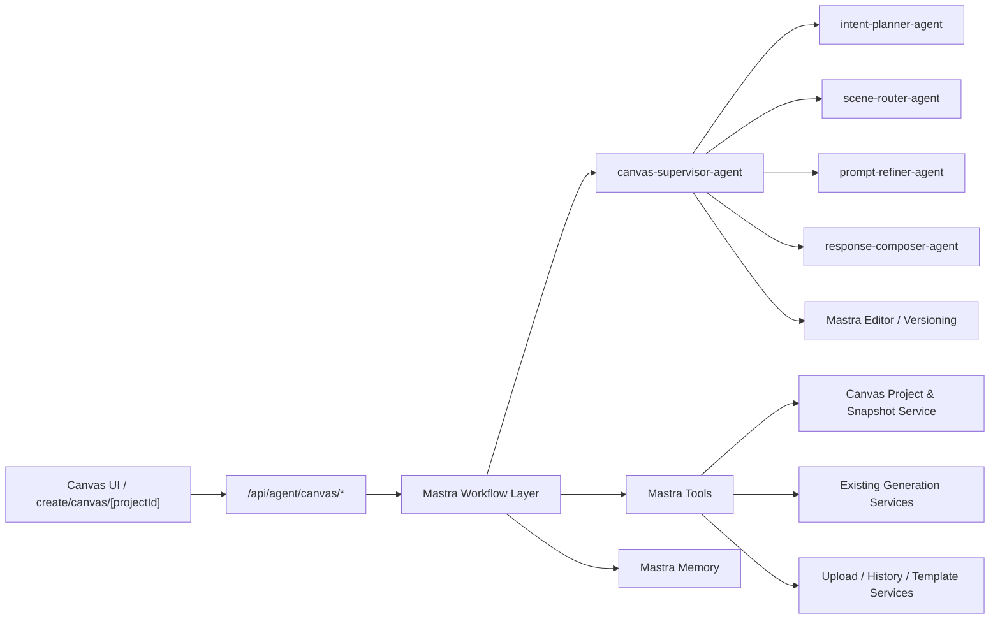

# 设计文档：Mastra Canvas Agent Architecture

## 上下文

当前 Create Canvas 已具备：

- 独立工作流画布
- 项目持久化与快照
- 生成适配层
- 本地 `canvas-agent-adapter` 预留接口

但“智能体”还没有正式的平台化运行时。页面目前更像“前端把聊天 UI、节点写入和生成触发串在一起”，这会带来三个结构性问题：

1. 复杂意图无法稳定拆解，前端会迅速变成巨型业务编排器
2. 多轮上下文、项目目标和用户偏好没有统一的记忆层
3. prompt / tools / 行为策略无法安全版本化，也无法交给非开发角色调优

Mastra 官方文档给了清晰边界：

- `Agents` 处理开放式任务与工具决策
- `Workflows` 处理确定步骤和执行顺序
- `Memory` 承载多轮会话与长期偏好
- `Editor` 将 prompt、工具描述和版本管理从代码解耦

因此本设计采用“Mastra 作为服务端智能体编排层，Canvas 作为前端交互与渲染层”的整体结构。

## 目标 / 非目标

- 目标：
  - 为 Create Canvas 建立正式的服务端智能体平台
- 保持现有生成 API、上传能力、项目快照和积分校验不变
- 为智能体聊天增加独立计费入口，但复用现有积分扣减与返还体系
  - 让智能体输出结构化画布操作，而不是直接耦合前端组件
  - 让 prompt、工具描述和 Agent 版本可以通过 Editor 管理
  - 让多轮会话围绕 `projectId` 形成稳定上下文
- 非目标：
  - 不把 React Flow 或画布 DOM 放进 Mastra
  - 不让 Agent 直接写浏览器状态
  - 不把所有 UI 手势都改成服务端驱动
  - 不在本阶段重做现有 AI 任务队列或资产模型

## 总体架构



核心原则：

1. 前端只负责交互、渲染和局部即时状态
2. Mastra Agent 只负责“理解目标、生成计划、决定调用哪些工具”
3. 真正的状态变更和生成执行由 Workflow + Tools 在服务端完成
4. 画布图快照仍以现有 `workbench_canvas_project` / snapshot 体系为真相源

## 决策

### 决策 1：Mastra 只放在服务端，前端不直接运行 Agent

原因：

- 避免前端泄露模型 key、工具 key 或运行时策略
- 避免把大段推理和上下文管理耦合进浏览器
- 让聊天、版本管理、会话记忆和可观测性都落到统一后端

结论：

- 前端只调用 `api/agent/canvas`
- Mastra 实例、Agent、Workflow、Memory、Editor 都在服务端注册

### 决策 2：用 Agent 负责开放式理解，用 Workflow 负责确定执行

根据 Mastra 官方建议：

- 当任务是开放式、步骤未知时，用 `Agent`
- 当任务是确定步骤、有明确顺序时，用 `Workflow`

映射到本项目：

- “用户说一句自然语言，希望自动完成创作” 属于 Agent 擅长范围
- “读取项目 -> 解析上下文 -> 产出结构化操作 -> 校验 -> 落图 -> 调生成 -> 回流结果” 属于 Workflow 擅长范围

因此：

- Agent 负责生成 `AgentPlan`
- Workflow 负责执行 `AgentPlan`

### 决策 3：采用 Supervisor + Sub-agents，而不是单一万能 Agent

参考 Mastra 的 supervisor agent 模式，推荐以下分工：

#### `canvas-supervisor-agent`

- 负责总协调
- 根据任务决定是否委派
- 汇总子 Agent 产出的计划与建议

#### `intent-planner-agent`

- 将自然语言请求转为结构化创作意图
- 输出媒体类型、目标风格、是否需要多步骤、是否需要参考图

#### `scene-router-agent`

- 将创作意图映射到现有 scene / model 体系
- 只做推荐，不直接执行生成

#### `prompt-refiner-agent`

- 在不改变用户目标的前提下生成更适合模型的 prompt 草案
- 输出 prompt、negative prompt、镜头/画面关键词建议

#### `response-composer-agent`

- 负责把当前系统状态组织成适合 UI 展示的解释文本
- 例如“我已为你创建文生视频工作流，并引用了当前首图作为参考”

这样做的好处：

- 每个 Agent 职责单一，便于版本化和调优
- 后续新增具体场景 skill 时，只需新增子 Agent、skill 文件或提示词块
- 符合 Mastra 对多 Agent 分工和委派的设计方式

### 决策 3.1：Skills 基于 Mastra Workspace 能力实现

参考 Mastra 的 Workspace Skills 文档，skills 应作为 Workspace 的原生能力接入，而不是单独发明一套“自定义技能系统”。官方能力的关键点是：

- skill 遵循 Agent Skills 规范
- 每个 skill 是一个包含 `SKILL.md` 的目录
- 可选包含 `references/`、`scripts/`、`assets/`
- 配置到 `Workspace.skills` 后，Agent 会自动获得 `skill`、`skill_read`、`skill_search` 三类工具
- skill 是按需加载的，无需维护单独的激活状态

因此，本项目中的 `skills` 不应只是前端展示卡片，而应成为智能体运行时的一等配置对象。第一期先只接入通用的 skill 能力底座，不预置具体业务 skill。

后续每个 skill 至少包含：

- `id`、`name`、`description`
- 可见的欢迎文案和建议入口
- 对应的 `SKILL.md` 指令正文
- `references/` 中的场景说明、品牌规范或生成策略
- `assets/` 中的示例图、图标或结构化素材
- 可用工具白名单
- 默认工作流骨架
- 默认布局策略
- 输出媒体偏好与模型偏好

能力完整后，运行时流程建议为：

1. 用户显式选择 skill，或由 supervisor 自动推断最匹配 skill
2. `scene-router-agent` 基于 skill 缩小工具与骨架范围
3. Workflow 依据 skill 生成节点、边和布局
4. `response-composer-agent` 输出与该 skill 一致的回复风格

这样可以把“一个大而全的通用 Agent”收敛为“共享底座 + 多个技能包”。但第一期只需要把底座接通，不要求同步交付具体技能包。

同时需要注意，前端 skill 卡片只是 UI 层的入口；真正被 Agent 消费的是 Workspace 中的 skill 文件。

### 决策 4：Tool 只暴露正式服务能力，不暴露 React 组件语义

Mastra Tool 应只包服务能力，不应理解浏览器局部状态。

推荐 Tool 分组：

#### 画布读取工具

- `getCanvasProject`
- `getCanvasSnapshot`
- `getCanvasSelectionContext`
- `listReferenceableNodes`

#### 画布写入工具

- `createCanvasWorkflowNode`
- `createCanvasInputNode`
- `updateCanvasWorkflowNode`
- `createCanvasEdge`
- `layoutCanvasNodes`

#### 生成工具

- `generateImageFromWorkflow`
- `generateVideoFromWorkflow`
- `estimateCreditsForWorkflow`

#### 资产与素材工具

- `listRecentCreations`
- `listTemplateCatalog`
- `attachHistoryCreationAsReference`
- `uploadReferenceAsset`
- `resolveMentionedReferences`

所有工具必须：

- 使用 schema 定义输入输出
- 在服务端复用现有项目模型和生成服务
- 做用户权限校验
- 记录调用审计

当前已落地第一批读取工具：

- `getCanvasProject`
- `getCanvasSnapshot`
- `getCanvasSelectionContext`
- `listReferenceableNodes`

它们通过 Mastra `requestContext` 注入 `userId / projectId / threadId / selectedNodeIds`，不会把权限相关字段交给模型自由生成。

当前也已落地第一批写入工具：

- `applyCanvasOperations`
- `createCanvasWorkflowFromRequest`

这两类工具直接复用现有 `CanvasAgentOperation` 协议，把节点创建、参考连线和布局结果写回 `workbench_canvas_snapshot`，避免前后端各自维护不同的落图语义。

当前 `/api/agent/canvas/message` 也已优先返回服务端持久化后的 snapshot 与 `createdWorkflowNodeIds`。前端在拿到 snapshot 时会直接回灌本地 graph，并以该 snapshot version 作为新的保存基线，而不是再次本地重放一遍 operations。

当前在 Mastra 成功路径中，snapshot 持久化已经从 route 手动执行收回到 `canvas-chat-request-workflow` 的最后一步。也就是说：

1. workflow 负责产出 `plan + operations`
2. workflow 负责把 operations 写入 `workbench_canvas_snapshot`
3. route 主要负责鉴权、聊天计费、消息落库和 fallback

生成工具当前已提供两层能力：

- `prepareCanvasWorkflowGeneration`
- `submitCanvasWorkflowGeneration`

其中：

1. `prepareCanvasWorkflowGeneration` 负责从指定 workflow 节点整理 prompt、settings、references 和 model 信息
2. `submitCanvasWorkflowGeneration` 负责在服务端复用现有 `/api/ai/[scene]/generate` 链路提交正式任务

当前第一阶段已把 4 条主路径收进服务端提交：

- `/text-to-image/gpt-image-2`
- `/image-to-image/gpt-image-2`
- `/text-to-video/seedance-1-5-pro`
- `/image-to-video/seedance-1-5-pro`

`canvas-chat-request-workflow` 在完成 snapshot 持久化后，会继续尝试为新创建的 workflow 节点提交生成任务，并把 `generationSubmissions` 一并返回给 `/api/agent/canvas/message`。前端若拿到 `server-submitted` 任务，则直接创建 pending result 节点并轮询现有 `/api/ai/status` 结果；未接入服务端提交的模型则保持 `client-deferred`，回退到现有前端 `PlaygroundConfig.onGenerate(...)` 适配层。

同时，聊天消息本身现在会持久化生成状态回写：

- 新增 `/api/agent/canvas/message-generation`
- assistant 消息的 `generationJson` 会记录任务提交、完成、失败状态
- 当任务成功时，会附带 outputs 与 creationRecordIds
- 当任务失败时，会附带 errorMessage

这样重新打开同一个 `projectId` 的 thread 时，不只能恢复聊天文本，还能恢复每条 assistant 消息对应的生成任务进度摘要。

当前右侧 Agent Dock 也已消费这份 `generation` 摘要：assistant 气泡会显示“已提交生成 / 生成完成 / 生成失败 / 部分完成”等状态，并在存在多任务时展示任务列表与失败原因。前端在任务状态变化时会先本地乐观更新当前消息，再用轻量防抖同步一次 thread，避免状态只在下次打开页面时才可见。

当前消息流还新增了结构化卡片协议，并统一落在消息 `partsJson` 中：

- assistant 消息会在 `partsJson` 中持久化 `canvas-agent-scene-router-card`
- 该卡片只保存稳定 payload：`subtype`、`preferredModelUrl`、`prompt`、`workflowNodeIds`
- 前端收到后，会基于当前 `scene registry + PlaygroundConfig.schema` 解析成可交互的参数卡
- 用户可以直接在卡片里切换模型、修改 prompt / aspect ratio / seed / duration 等参数
- 卡片支持“应用到画布”和“重新生成”两个动作，避免用户必须先去节点右侧 composer 再做二次编辑

为了让消息流里的卡片形态统一，右侧 Dock 现在把以下三类卡片全部改为 `json-render` 渲染：

- 欢迎区建议卡
- scene router 场景参数卡
- 生成状态卡

当前又补了一层“执行确认卡”与 `Ask / Auto` 模式：

- `Auto` 模式会在服务端完成提示词优化、节点落图、自动编组后，继续提交正式生成
- `Ask` 模式会同样先完成提示词优化、节点落图和自动编组，但不会立即提交生成，而是把一张 `execution-review` 卡片持久化到消息 `partsJson`
- 前端通过 `json-render` 渲染这张确认卡，展示本次创建的文本节点、参考图节点和工作流节点，并提供“确认执行”按钮
- 当用户确认时，前端只负责调用既有 workflow 生成链路；是否自动执行由服务端 `executionMode` 真正控制，而不是仅靠前端视觉开关

为了让过短输入也能顺畅进入画布，当前 pre-Mastra 与 Mastra 主路径都补了短文案优化约定：

- 若输入文本过短，系统会先把它扩展成更适合生成的 refined prompt
- 若这是当前 thread 内的首条有效文本消息，则会把 refined prompt 自动创建为一个文本节点
- 上传图片会自动初始化为参考图输入节点，不再要求用户先手动把附件挂到画布
- 文本节点、参考图节点和工作流节点会共享同一个 group label，用于在画布节点头部和消息确认卡中表达“这一组是同一次智能体搭图结果”

对于短提示词，消息流里现在还会补一张更轻量的 `prompt-guide` 引导卡：

- 只有在输入过短时才出现，不替代自动 prompt 优化
- 卡片选项优先由 `response-composer-agent` 基于用户当前输入动态生成，而不是写死固定方向
- 点击选项会把更完整的提示词回填到输入框，方便用户继续修改或发送
- 该卡片同样通过 `json-render` 渲染，并采用更紧凑的列表样式

同时，图片 / 视频生成场景参数卡也已压缩成更紧凑的确认面板：

- 标题、prompt 预览、模型选择、参数编辑和按钮都改成更密的结构
- 视觉上更接近“确认卡”而不是“大表单”
- 避免在右侧窄面板里占用过高垂直空间

这里使用的是 `@json-render/core + @json-render/react`，并在前端注册了自定义 catalog。这样做的边界是：

1. 服务端只负责持久化稳定 card payload，不直接生成前端耦合的 JSX
2. 前端通过 `json-render` 统一执行卡片渲染，但具体业务交互仍绑定现有 canvas graph actions
3. 后续如果需要新增 billing 卡、skill 卡或引用解析卡，只需扩展 card part 类型与 catalog 组件，而不必继续堆积消息气泡内的条件分支

### 决策 4.3：上传图片与 `@参考图` 引用必须走同一引用解析链路

Canvas Agent 需要同时支持两类参考来源：

- 用户在聊天中直接上传的图片
- 当前画布、历史作品或已上传素材中被 `@` 明确引用的参考图

为了避免前端和服务端各自维护一套引用逻辑，系统应统一为“可解析参考项”模型：

1. 前端上传图片后，先得到正式资产记录或临时上传记录
2. 消息提交时把上传图片作为 attachment 一并传入
3. 消息正文中的 `@xxx` 再解析为明确的 reference target
4. Workflow 统一把 attachment 和 `@引用` 映射为 input node、reference edge 或直接的 workflow reference 参数

这样用户既可以“先上传，再发消息”，也可以“先在画布里已有图，再用 `@参考图` 精确指定”。

推荐约束：

- `@引用` 只解析当前项目内可见且可授权的参考项
- attachment 与 `@引用` 都要保留 source metadata
- 聊天记录中需要保存本次消息所引用的 reference ids 和上传资产 ids

### 决策 4.1：聊天计费与生成计费必须分账

Canvas Agent 的“聊天请求”与“图片 / 视频生成请求”属于两种不同成本来源，因此计费上必须拆开：

- 聊天计费：覆盖 Agent 推理、skill 读取、工具决策和结构化计划产出
- 生成计费：覆盖现有图片 / 视频模型调用成本

两者可以发生在同一条消息中，但账务上不能混成一次模糊扣费，否则：

- 用户无法理解为什么单次对话会消耗多少积分
- 后续无法单独调整聊天定价
- 失败返还时无法判断该返还聊天费、生成费还是两者都返

因此建议：

1. `POST /api/agent/canvas/message` 先做聊天计费校验与扣费
2. 若该消息后续触发图片 / 视频生成，再按现有生成链路单独扣费
3. 两笔消费使用不同的 `scene` 和 `description`
4. 两笔消费都写入独立 metadata，便于审计和退款

首期实现上不另起一套账本，而是复用现有 `checkAndConsumeCredits` / `consumeCredits` / 返还逻辑。

### 决策 4.2：聊天计费在消息入口完成，并支持失败返还

推荐在 `POST /api/agent/canvas/message` 的服务端入口执行聊天计费，而不是分散到各个 tool 内部。理由是：

- 计费粒度应与“用户发出一条消息”对齐
- 多个 tool 可能在同一条消息里被调用，不能按 tool 次数重复扣费
- 更容易做幂等、失败返还和追踪

推荐时序：

1. 用户发送消息
2. 服务端计算本次聊天所需积分
3. 调用现有积分消费能力完成聊天扣费
4. Agent / Workflow 继续执行
5. 如果消息在正式执行前失败，按统一返还逻辑返还聊天积分
6. 如果消息已成功生成结构化结果，则聊天积分不返还

推荐 metadata 至少包含：

- `projectId`
- `threadId`
- `messageId`
- `skillId`
- `selectedNodeIds`
- `billingType: "agent-chat"`

这样能把“聊天理解成本”与“模型生成成本”分清楚，同时保持现有账务模型不变。

当前预接入实现补充：

- 在正式 Mastra 接入前，聊天费先按固定 `1` 积分执行
- 扣费发生在 `POST /api/agent/canvas/message`
- 若消息在 assistant 结果持久化前失败，则立即走返还逻辑
- 生成费仍沿用现有图片 / 视频生成链路，不与聊天费混扣

当前 pre-Mastra 代码形态补充：

- 已新增 `src/shared/services/canvas-agent/`
- 其中 `canvas-agent-plan.ts` 负责把消息理解结果收敛成结构化 `CanvasAgentOperation[]`
- `canvas-agent-layout.ts` 负责生成最小稳定布局
- `canvas-agent-executor.ts` 负责向 API 路由返回统一的 `plan + operations`
- 前端 `/create/canvas` 当前改为严格消费这些 operation，而不是继续在页面里推断引用节点和连线

当前 Mastra 落地进展补充：

- 已安装 `mastra` 与 `@mastra/core`
- 已新增 `src/mastra/index.ts` 作为主 Mastra 实例入口
- 已新增 `src/mastra/workspace/canvas-agent-workspace.ts`
- 已新增 `src/mastra/agents/canvas-supervisor-agent.ts`
- 已新增 `src/mastra/agents/intent-planner-agent.ts`
- 已新增 `src/mastra/agents/response-composer-agent.ts`
- 已新增 `src/mastra/workflows/canvas-chat-request-workflow.ts`
- `/api/agent/canvas/message` 当前改为优先执行 Mastra workflow，失败时自动回退本地 planner
- 已新增 `src/mastra/memory/canvas-agent-memory.ts`
- 当前通过 `threadId + resourceId(canvas-project:${projectId})` 绑定 Mastra memory
- 当前会将已保存的线程历史消息回灌为 agent context，以补足 MockMemory 非持久化的限制
- 当前 workflow 内部已经拆出 `intent planner`、`prompt refiner`、`scene router` 与 `response composer` 四段主路径，`refinedPrompt` 与 `preferredModelUrl` 会继续传给结构化 operations 和前端落图执行
- 当前已接入最小 memory 绑定、聊天历史回灌与 `MastraEditor` 注册
- 当前 editor 先采用默认 provider 运行，作为 code-defined agent 的运行时 override 与版本化入口；持久化 provider 与 Studio 深度运营能力后续再继续增强
- 当前 `POST /api/agent/canvas/message` 保留了显式回滚开关：当 `CANVAS_AGENT_ENABLE_MASTRA=false` 时，会直接退回本地 planner / executor 链路，便于灰度和故障切换

### 决策 5：Agent 不直接改前端图，而是输出结构化操作计划

不让 Agent 直接“操作页面”，而是先产出结构化 `AgentPlan`：

```ts
type AgentPlan = {
  summary: string;
  mediaIntent: "image" | "video";
  targetWorkflow: {
    mode: "reuse-selected" | "create-new";
    subtype:
      | "text-to-image"
      | "image-to-image"
      | "text-to-video"
      | "image-to-video";
    sceneId?: string;
    modelUrl?: string;
  };
  references: Array<{
    nodeId: string;
    relation: "reference" | "control";
  }>;
  operations: Array<
    | { type: "create-node"; payload: unknown }
    | { type: "update-node"; payload: unknown }
    | { type: "create-edge"; payload: unknown }
    | { type: "layout"; payload: unknown }
  >;
  shouldGenerate: boolean;
};
```

随后由 Workflow：

1. 校验 `AgentPlan`
2. 把计划映射为正式 service 调用
3. 更新项目快照
4. 再决定是否触发生成

这可以把“模型输出”与“正式状态变更”隔开，降低失控风险。

### 决策 5.1：自动生成画布节点必须是一级能力

本项目中的 Agent 不能只停留在“聊天回复 + 触发一次生成”。当用户提出创作目标时，系统必须支持自动搭建对应的画布工作流，也就是自动完成：

1. 选择要创建的节点类型
2. 决定节点之间的引用关系和控制关系
3. 为节点生成初始化参数
4. 为整组节点生成稳定布局
5. 将节点、边和布局一次性保存为正式快照

因此，“自动生成画布节点”应是 Workflow 的标准执行步骤，而不是页面里的附属逻辑。

### 决策 5.2：用 `CanvasOperation` 作为自动落图的唯一写入契约

为了让 Agent 稳定自动生成节点，`AgentPlan.operations` 不能长期停留在 `unknown payload`。建议收敛为可校验的 `CanvasOperation`：

```ts
type CanvasOperation =
  | {
      type: "create-node";
      nodeType: "workflow" | "input" | "result" | "note";
      subtype?: string;
      clientKey: string;
      position?: { x: number; y: number };
      payload: Record<string, unknown>;
    }
  | {
      type: "update-node";
      nodeId: string;
      payload: Record<string, unknown>;
    }
  | {
      type: "create-edge";
      edgeType: "reference" | "control" | "result";
      sourceNodeId: string;
      targetNodeId: string;
      payload?: Record<string, unknown>;
    }
  | {
      type: "layout";
      strategy: "right-column-stack" | "workflow-chain" | "fan-out-grid";
      nodeKeys: string[];
      anchorNodeId?: string;
    };
```

其中：

- `clientKey` 用于同一条消息内关联新建节点与后续连线
- `layout.strategy` 让 Agent 只描述布局意图，不直接控制脆弱坐标
- `nodeType + subtype` 让服务端能验证是否为允许生成的画布节点

### 决策 5.3：自动节点生成采用骨架实例化，而不是完全自由绘图

为了控制稳定性，Agent 不应完全自由发明图结构，而应先选择工作流骨架，再由 Workflow 实例化：

- `single-text-to-image`
- `single-image-to-image`
- `single-text-to-video`
- `single-image-to-video`
- `reference-image-stack`
- `marketing-video-sequence`

每个骨架都应定义：

- 需要哪些节点
- 允许哪些自动补全字段
- 默认边关系
- 默认布局策略

这会把“自动生成画布节点”从自由绘图收敛成受控装配。

### 决策 6：Memory 绑定项目，而不是绑定单次页面生命周期

根据 Mastra memory 文档，记忆最适合多轮会话。

本项目建议：

- `threadId = canvas-agent:${projectId}:${sessionId}`
- `resourceId = canvas-project:${projectId}`

Memory 分层：

#### Message history

- 保存用户消息、Agent 回复、关键工具结果
- 支撑同一项目内多轮追问

#### Working memory

- 保存用户的稳定偏好
- 例如品牌语气、视觉调性、常用比例、禁用元素

#### Observational memory

- 后续启用
- 用于把长对话压缩成高密度观察，避免上下文窗口失控

#### Semantic recall

- 后续启用
- 用于从历史项目或长线程中召回相关案例

重要边界：

- 画布节点与边仍存于项目快照，不放进 memory 作为真相源
- memory 只存对话和偏好，不替代项目模型

### 决策 6.1：聊天记录必须持久化保存，并与 Canvas Project 强关联

仅依赖 Mastra memory 不足以满足业务要求，因为 memory 更偏向智能体上下文与召回，不等同于正式业务聊天记录。因此系统必须同时保存正式聊天记录，并与 `projectId` 建立强关联。

建议：

- 每条聊天消息都保存 `projectId`
- 会话层保存 `threadId / sessionId / resourceId`
- 消息层保存用户消息、assistant 回复、计费结果、生成结果摘要和关键操作引用
- 页面重新进入 `/{locale}/create/canvas/[projectId]` 时，可以直接按 `projectId` 恢复聊天记录

边界建议：

- memory：服务于 Agent 推理与上下文压缩
- chat records：服务于业务展示、历史恢复、审计和后续运营分析

这两个层次可以复用同一线程标识，但不能互相替代。

### 决策 6.2：上传图片以 `workbench_creation` 为资产真相源，聊天层只做引用映射

本项目已经有 `workbench_creation` 作为图片/视频结果的统一资产模型，因此聊天里的上传图片不建议再新建独立资产表。更稳妥的做法是：

- 上传图片先进入现有上传链路
- 产出一条 `workbench_creation` 记录作为正式资产
- Agent 聊天消息只保存对该资产的引用关系

这样能避免：

- 上传图片和历史作品分成两套资产身份
- `@参考图` 解析后还要在多套资产表之间切换
- 画布节点、聊天附件和历史作品无法共享同一资产 id

结论：

- `assetId` 默认即 `workbench_creation.id`
- 聊天表负责保存“消息与资产的关系”
- 画布表负责保存“项目与生成结果的关系”

### 决策 7：使用 Mastra Editor 管理 prompt 与工具描述版本

Mastra Editor 文档强调：

- editor 用于把 agent 配置与代码解耦
- 可以为 code-defined agent 建立 stored override
- 每次修改产生 draft / published / archived 版本

映射到本项目：

- 代码中定义基线 Agent、Tool、Workflow
- 通过 Editor 让运营 / prompt 工程 / 产品调优：
  - Agent instructions
  - Prompt blocks
  - Tool descriptions
- 生产默认走 `published`
- staging 或灰度用户可走 `draft` 或指定 `versionId`

这能避免每次智能体微调都走部署。

### 决策 8：为 Create Canvas 提供专用 Agent API，而不是复用现有 chat API

当前通用 chat API 更适合纯文本对话，不适合结构化画布操作。

建议新增：

- `POST /api/agent/canvas/session`
  - 创建或恢复项目内 Agent 会话
- `POST /api/agent/canvas/message`
  - 提交一条聊天消息
  - 返回结构化操作、解释文本、任务状态
- `GET /api/agent/canvas/thread/:threadId`
  - 拉取会话历史

前端收到响应后：

- 应用 `operations`
- 更新本地图和服务器快照
- 若有生成任务，监听或轮询结果，再把结果节点回写

## 推荐目录结构

```text
src/mastra/
  index.ts
  workspace/
    canvas-agent-workspace.ts
  skills/
    _template/
      SKILL.md
      references/
  agents/
    canvas-supervisor-agent.ts
    intent-planner-agent.ts
    scene-router-agent.ts
    prompt-refiner-agent.ts
    response-composer-agent.ts
  workflows/
    canvas-chat-request-workflow.ts
    canvas-generate-workflow.ts
  tools/
    canvas-project-tools.ts
    canvas-graph-tools.ts
    canvas-generation-tools.ts
    canvas-asset-tools.ts
  prompts/
    canvas-agent-prompts.ts
  memory/
    canvas-memory.ts
  editor/
    canvas-editor.ts
```

## 当前项目内落地方案

本项目不新起独立仓库，而是在当前仓库内新增一层 Mastra 服务端运行时。这样可以直接复用现有：

- 用户登录态与权限校验
- `workbench_canvas_project` / `workbench_canvas_snapshot`
- `workbench_creation`、上传与模板体系
- 现有 `playground-config-registry` 与 `currentConfig.onGenerate(...)`
- 积分估算、访问校验与任务状态查询

### 代码组织原则

1. `src/app` 继续负责页面与 Next.js API route
2. `src/shared/models` 继续作为项目实体与数据库读写层
3. `src/shared/services` 继续承载稳定业务服务
4. `src/mastra` 只负责智能体平台运行时

也就是说，Mastra 不直接越过 service / model 层访问数据库，而是调用当前项目已有服务。

### 推荐同仓目录

```text
src/
  app/
    api/
      agent/
        canvas/
          session/route.ts
          message/route.ts
          thread/[threadId]/route.ts
  mastra/
    index.ts
    skills/
    agents/
    workflows/
    tools/
    prompts/
    memory/
    editor/
  shared/
    services/
      canvas-agent/
        canvas-agent-session.ts
        canvas-agent-chat-record.ts
        canvas-agent-plan.ts
        canvas-agent-executor.ts
        canvas-agent-events.ts
        canvas-agent-billing.ts
```

这里建议在 `src/shared/services/canvas-agent/` 再加一层“应用服务”，把 Mastra tools 和现有 model/service 之间的适配逻辑收拢起来，避免所有业务判断都挤进 tool 文件。

## 模块级实现细化

### 1. `src/mastra/index.ts`

职责：

- 创建 `Mastra` 实例
- 注册 agents / workflows / editor
- 注册 memory storage provider

建议：

- 先不全局替换现有任何能力
- 只注册 canvas 相关 agent 与 workflow
- 通过懒加载或独立导出，避免把运行时无意义地注入所有页面

### 1.1 `src/mastra/workspace/canvas-agent-workspace.ts`

职责：

- 创建 Canvas Agent 专用 `Workspace`
- 注册 skills 目录
- 根据需要接入 search、filesystem 和受控 sandbox

建议：

```ts
new Workspace({
  id: "canvas-agent-workspace",
  skills: ["/skills"],
  bm25: true,
  autoIndexPaths: ["/skills"],
});
```

首期建议：

- 先启用 `skills + search`
- 默认不开启可写 filesystem
- 默认不开启 sandbox 执行

这样能先用上 Mastra 原生 skills 能力，同时保持运行时边界足够收敛。

### 2. `src/mastra/agents/*`

首批建议 4 个：

#### `canvas-supervisor-agent.ts`

- 模型：主推理模型
- 输入：用户消息、项目摘要、选中上下文、可引用节点摘要
- 输出：结构化 `AgentPlan`
- 职责：统筹调度，决定是否委派

#### `intent-planner-agent.ts`

- 输入：用户消息、项目上下文
- 输出：
  - 媒体意图
  - 任务类型
  - 参考依赖
  - 是否需要创建新工作流

#### `scene-router-agent.ts`

- 输入：意图与可用 scene/model 列表
- 输出：推荐 sceneId / modelUrl / workflow subtype

#### `response-composer-agent.ts`

- 输入：已执行操作、生成状态、结果摘要
- 输出：前端展示文案

说明：

- `prompt-refiner-agent` 可以放到第二批，不必第一期硬上
- 第一批先保住“正确落图 + 正确触发生成”

### 2.1 `src/mastra/skills/*`

建议把每个场景能力实现为一个独立 skill 目录，而不是把全部说明硬编码进 supervisor。第一期先保留模板目录和发现能力即可。

每个 skill 目录建议包含：

- `SKILL.md`
- `references/*.md`
- 可选的 `assets/*`
- 可选的 `scripts/*`

其中：

- `SKILL.md` 定义该 skill 的任务边界、使用流程、输出要求
- `references/` 存放该 skill 的长文档说明
- `scripts/` 只在确实需要本地处理时启用，且受 Workspace 权限控制

如果前端需要额外展示元数据，可保留一份轻量 `canvas-skill-registry.ts` 仅用于 UI 展示和 `skillId` 映射，但 Agent 实际消费内容应来自 Workspace skills。第一期这份 registry 也可以为空或只保留占位项。

当前实现补充：

- 已新增 `canvas-agent-skill.ts`，用于收口显式 `skillId` 与后续自动 skill 路由协议
- 已新增 `canvas-agent-skill-registry.ts`，用于提供轻量 UI 展示元数据
- 当前 `POST /api/agent/canvas/message` 会返回 `skillSelection`，作为请求侧 skill 路由结果摘要

### 3. `src/mastra/tools/*`

首批不要把工具做得过细，否则维护成本会很高。建议按“稳定服务边界”收口。

#### `canvas-project-tools.ts`

- `getCanvasProjectContext`
- `getCanvasSnapshotGraph`
- `listReferenceableCanvasNodes`

底层复用：

- `getWorkbenchCanvasProjectById`
- 现有 snapshot 读取逻辑

#### `canvas-graph-tools.ts`

- `createWorkflowNode`
- `createInputNode`
- `updateWorkflowNode`
- `createReferenceEdge`
- `createControlEdge`
- `applyCanvasLayout`
- `applyCanvasOperations`

底层复用：

- 新增 `canvas-agent-executor.ts`
- 调用现有 graph 结构和 snapshot 保存能力

#### `canvas-generation-tools.ts`

- `estimateWorkflowCredits`
- `runWorkflowGeneration`
- `pollWorkflowTaskResult`

底层复用：

- `playground-config-registry`
- `canvas-generation-adapter` 里可抽离出的纯服务逻辑
- 现有 `/api/ai/status` 查询逻辑对应的服务函数

#### `canvas-asset-tools.ts`

- `listRecentCanvasCreations`
- `listApplicableCanvasTemplates`
- `attachHistoryCreationReference`
- `uploadReferenceAsset`
- `resolveMentionedReferences`

底层复用：

- `workbench_creation`
- 模板 catalog
- 现有上传接口与媒体资产模型

当前实现补充：

- 已落地 `listRecentCanvasCreations`
- 已落地 `listRecentCanvasUploads`
- 已落地 `listCanvasTemplateCatalog`
- 已落地 `resolveMentionedReferences`

这样 supervisor 和各子 agent 在需要时可以直接读取历史作品、上传素材、模板目录和 `@参考图` 解析结果，而不需要继续依赖 route 内联逻辑。

### 4. `src/mastra/workflows/*`

建议拆成两个工作流：

#### `canvas-chat-request-workflow.ts`

步骤：

1. 校验用户与项目权限
2. 计算并扣除本次聊天积分
3. 读取项目上下文
4. 调 supervisor agent
5. 校验 `AgentPlan`
6. 将 `AgentPlan.operations` 规范化为 `CanvasOperation[]`
7. 批量写入节点、边与布局
8. 保存 snapshot 版本并返回受影响节点
9. 若无需生成，直接返回
10. 若需要生成，调用生成工作流

#### `canvas-generate-workflow.ts`

步骤：

1. 读取目标 workflow node
2. 转换为现有生成参数
3. 调现有生成链路
4. 保存 taskId 与 pending 状态
5. 结果回流为 result node 或更新 workflow node

这样拆分的好处：

- 聊天编排与实际生成解耦
- 后续“点击按钮直接生成”也可复用第二条工作流

当前实现补充：

- 已新增独立 `canvas-generate-workflow.ts`
- 当前主消息工作流仍会在成功路径中直接尝试提交生成，独立生成工作流用于后续复用和进一步解耦
- 前端和消息记录都已经能消费独立任务提交后的 `generationSubmissions`

### 5. `src/shared/services/canvas-agent/*`

建议把自动生成节点的核心能力收敛到应用服务层，而不是散落在 tool 文件里。

#### `canvas-agent-plan.ts`

- 定义 `AgentPlan`
- 定义 `CanvasOperation`
- 定义工作流骨架、节点白名单和布局策略

#### `canvas-agent-executor.ts`

- 将 `CanvasOperation[]` 映射为正式 graph 变更
- 负责 `clientKey -> nodeId` 的一次性解析
- 批量创建节点、边和布局
- 统一保存 snapshot

#### `canvas-agent-layout.ts`

- 根据 `layout.strategy` 生成稳定坐标
- 避免让模型直接输出像素级位置

#### `canvas-agent-idempotency.ts`

- 基于 `projectId + threadId + messageId` 生成幂等键
- 防止重试或重复提交时生成重复节点
- 防止同一条消息重复扣聊天积分

当前状态：

- 已定义幂等能力的目标边界，但尚未落独立 `canvas-agent-idempotency.ts`
- 当前回滚开关、服务端 snapshot 真相源和消息级任务状态回写已经减少了大部分重复执行风险
- 后续仍需要把 `projectId + threadId + messageId` 的幂等键正式下沉成服务层能力

#### `canvas-agent-billing.ts`

- 计算聊天所需积分
- 调用现有 `checkAndConsumeCredits` 完成扣费
- 封装聊天失败时的返还逻辑
- 生成统一的 billing metadata 与 scene 标识

当前状态：

- 聊天失败返还已接入
- 生成失败返还仍沿用现有图片 / 视频任务系统
- 重复消息幂等扣费规则仍待继续补到独立幂等层
- 聊天扣费已从“固定 1 积分”升级为“按 token usage 折算 + 最低消费兜底”

聊天计费与生成计费规则建议明确为：

1. 聊天扣费发生在 `POST /api/agent/canvas/message`
2. 若 assistant 消息未持久化成功，则立即返还聊天费
3. 生成失败不返还聊天费，只沿用现有生成任务侧返还策略
4. 后续补齐幂等键后，同一 `projectId + threadId + messageId` 只能成功扣费一次

当前实现补充：

- 聊天积分基于 `inputTokens / outputTokens / reasoningTokens` 估算 USD 成本
- 再结合 `pricing.creditUnitPrice` 与 `pricing.defaultProfitMargin` 换算为积分
- 每条消息仍保留 `canvas_agent_chat_min_credits` 最低消费，避免超短消息或 usage 缺失导致 0 积分
- 后台已新增以下计费参数：
  - `canvas_agent_chat_input_price_per_million_usd`
  - `canvas_agent_chat_output_price_per_million_usd`
  - `canvas_agent_chat_reasoning_price_per_million_usd`
  - `canvas_agent_chat_min_credits`
- 当前默认单价对齐 `openai/gpt-4.1-mini`

#### `canvas-agent-chat-record.ts`

- 保存项目级聊天会话与消息记录
- 将 `threadId / sessionId` 与 `projectId` 建立关联
- 保存用户消息、assistant 回复、计费结果和任务摘要
- 保存上传图片、`@引用` 结果和关键 reference ids
- 支持按 `projectId` 恢复最近会话和消息列表

当前实现补充：

- assistant 消息会持久化 `generationJson`
- 前端会把任务提交、完成、失败状态实时回写到对应消息
- 重新进入项目时，thread 恢复会一并带回消息级生成状态摘要

## Workflow 恢复、重试与幂等

建议将失败恢复和重试策略分三层处理：

1. 聊天入口层
   - 使用 `messageId` 作为未来幂等键基础
   - 对同一消息重试时优先返回已存在结果，而不是重复落图
2. 生成执行层
   - 独立 `canvas-generate-workflow` 只负责从既有 workflow node 提交任务
   - 失败时允许按 workflow node 维度单独重试，不要求重跑整条聊天工作流
3. 消息状态层
   - assistant 消息的 `generationJson` 记录 submitted / completed / failed / partial
   - 前端刷新 thread 时以消息状态作为恢复入口，而不是只看本地 pending 节点

首期先保留现有回退路径：

- Mastra 主路径失败时，退回本地 planner / executor
- 服务端生成未接通时，退回 `client-deferred`
- 前端仍保留 `generateWorkflowNode(...)` 作为迁移期兜底

## 基于 skill 的工作流骨架

后续正式 skill 接入后，建议每个 skill 至少声明：

- 默认 `subtype`
- 默认 `preferredModelUrl`
- 默认节点骨架
- 默认 reference / control 边策略
- 默认 layout strategy

骨架实例化流程建议为：

1. 用户显式选择或自动命中 `skillId`
2. `scene-router-agent` 在 skill 约束内挑选 modelUrl
3. `canvas-agent-plan` 根据 skill 骨架生成 `CanvasOperation[]`
4. workflow 负责批量落图、布局和生成提交

第一期当前状态：

- 已保留 `skillId` 与 `skillSelection` 协议
- 已有轻量 registry 与 Workspace 技能目录
- 具体业务 skill 骨架仍待后续逐个补充

## 观测与治理

### 日志与 tracing 字段

当前建议至少统一记录以下字段：

- `toolName`
- `workflowId`
- `agentId`
- `userId`
- `projectId`
- `threadId`
- `messageId`
- `taskId`
- `status`
- `error`
- `at`

当前实现补充：

- 已新增 `canvas-agent-audit.ts`
- 读取、写入、生成、资产工具都会记录统一的 tool audit 日志
- 这层日志先以服务端 `console.info` 为落点，后续可接正式 tracing / APM

### 失败分类、告警与人工回放

建议最少分成以下失败类别：

- `auth-error`
- `billing-error`
- `tool-context-error`
- `snapshot-write-error`
- `generation-submit-error`
- `generation-result-error`
- `model-parse-error`

后续接告警时，可以以 `projectId / threadId / messageId / taskId` 作为聚合维度。  
人工回放建议优先支持：

- 重放某条 `messageId` 的输入
- 重放某个 `workflowNodeId` 的生成提交
- 查看该次工具调用审计日志

### 评测与自动调优接入点

后续评测建议围绕三类信号沉淀：

- 结构化正确性：是否生成了正确 subtype、正确 reference、正确布局
- 业务完成度：是否成功落图、是否成功起任务、是否成功回写消息状态
- 用户反馈：是否继续追问、是否手动改图、是否立即删除节点

自动调优接入点建议放在：

- agent instructions 版本对比
- skill 路由结果对比
- prompt refiner 输出对比
- scene router 的 modelUrl 选择对比

## 数据模型细化

### 1. `workbench_canvas_chat_thread`

用途：

- 保存某个 canvas project 下的一条正式聊天线程
- 作为 Mastra `threadId` 的业务落点

建议字段：

```ts
export const workbenchCanvasChatThread = pgTable(
  "workbench_canvas_chat_thread",
  {
    id: text("id").primaryKey(),
    userId: text("user_id")
      .notNull()
      .references(() => user.id, { onDelete: "cascade" }),
    projectId: text("project_id")
      .notNull()
      .references(() => workbenchCanvasProject.id, { onDelete: "cascade" }),
    sessionId: text("session_id").notNull(),
    resourceId: text("resource_id").notNull(),
    status: text("status").notNull().default("active"),
    title: text("title").notNull().default(""),
    lastMessageAt: timestamp("last_message_at"),
    createdAt: timestamp("created_at").defaultNow().notNull(),
    updatedAt: timestamp("updated_at")
      .defaultNow()
      .$onUpdate(() => new Date())
      .notNull(),
  },
  (table) => [
    index("idx_canvas_chat_thread_user_project").on(
      table.userId,
      table.projectId,
    ),
    index("idx_canvas_chat_thread_user_last_message").on(
      table.userId,
      table.lastMessageAt,
    ),
  ],
);
```

说明：

- `id` 直接作为业务 `threadId`
- 一个 `projectId` 可以有多条历史线程，但页面默认恢复 `lastMessageAt` 最新的一条
- `resourceId` 与 Mastra memory 对齐，格式继续使用 `canvas-project:${projectId}`

### 2. `workbench_canvas_chat_message`

用途：

- 保存用户消息和 assistant 回复主体
- 作为页面恢复、计费审计和任务回放的主表

建议字段：

```ts
export const workbenchCanvasChatMessage = pgTable(
  "workbench_canvas_chat_message",
  {
    id: text("id").primaryKey(),
    userId: text("user_id")
      .notNull()
      .references(() => user.id, { onDelete: "cascade" }),
    projectId: text("project_id")
      .notNull()
      .references(() => workbenchCanvasProject.id, { onDelete: "cascade" }),
    threadId: text("thread_id")
      .notNull()
      .references(() => workbenchCanvasChatThread.id, { onDelete: "cascade" }),
    clientMessageId: text("client_message_id"),
    role: text("role").notNull(),
    status: text("status").notNull().default("completed"),
    content: text("content").notNull(),
    partsJson: text("parts_json").notNull(),
    attachmentsJson: text("attachments_json"),
    mentionedReferencesJson: text("mentioned_references_json"),
    operationsJson: text("operations_json"),
    billingJson: text("billing_json"),
    generationJson: text("generation_json"),
    errorMessage: text("error_message"),
    createdAt: timestamp("created_at").defaultNow().notNull(),
    updatedAt: timestamp("updated_at")
      .defaultNow()
      .$onUpdate(() => new Date())
      .notNull(),
  },
  (table) => [
    index("idx_canvas_chat_message_thread_created").on(
      table.threadId,
      table.createdAt,
    ),
    index("idx_canvas_chat_message_project_created").on(
      table.projectId,
      table.createdAt,
    ),
    index("idx_canvas_chat_message_user_project").on(
      table.userId,
      table.projectId,
    ),
    uniqueIndex("uq_canvas_chat_message_thread_client").on(
      table.threadId,
      table.clientMessageId,
    ),
  ],
);
```

说明：

- `projectId` 冗余保存，避免每次都通过 thread 回表
- `clientMessageId` 用于前端重试幂等
- `attachmentsJson` / `mentionedReferencesJson` 保存渲染快照，便于页面直接恢复
- `operationsJson` / `billingJson` / `generationJson` 保存当次执行结果摘要

### 3. `workbench_canvas_chat_message_attachment`

用途：

- 规范化保存“消息引用了哪些上传图片/素材资产”
- 用于按资产、项目、消息回查

建议字段：

```ts
export const workbenchCanvasChatMessageAttachment = pgTable(
  "workbench_canvas_chat_message_attachment",
  {
    id: text("id").primaryKey(),
    userId: text("user_id")
      .notNull()
      .references(() => user.id, { onDelete: "cascade" }),
    projectId: text("project_id")
      .notNull()
      .references(() => workbenchCanvasProject.id, { onDelete: "cascade" }),
    threadId: text("thread_id")
      .notNull()
      .references(() => workbenchCanvasChatThread.id, { onDelete: "cascade" }),
    messageId: text("message_id")
      .notNull()
      .references(() => workbenchCanvasChatMessage.id, { onDelete: "cascade" }),
    assetId: text("asset_id")
      .notNull()
      .references(() => workbenchCreation.id, { onDelete: "cascade" }),
    kind: text("kind").notNull().default("image"),
    orderIndex: integer("order_index").default(0).notNull(),
    source: text("source").notNull().default("upload"),
    nodeId: text("node_id"),
    label: text("label"),
    metadataJson: text("metadata_json"),
    createdAt: timestamp("created_at").defaultNow().notNull(),
  },
  (table) => [
    index("idx_canvas_chat_attachment_message_order").on(
      table.messageId,
      table.orderIndex,
    ),
    index("idx_canvas_chat_attachment_project_asset").on(
      table.projectId,
      table.assetId,
    ),
  ],
);
```

说明：

- `assetId` 直接指向 `workbench_creation.id`
- `nodeId` 用于记录该资产是否已经挂到某个 canvas 节点
- `source` 可取 `upload | canvas-node | history`

### 4. `workbench_canvas_chat_message_reference`

用途：

- 保存正文中 `@参考图` 的解析结果
- 保留 mention 文本与最终目标之间的映射

建议字段：

```ts
export const workbenchCanvasChatMessageReference = pgTable(
  "workbench_canvas_chat_message_reference",
  {
    id: text("id").primaryKey(),
    userId: text("user_id")
      .notNull()
      .references(() => user.id, { onDelete: "cascade" }),
    projectId: text("project_id")
      .notNull()
      .references(() => workbenchCanvasProject.id, { onDelete: "cascade" }),
    threadId: text("thread_id")
      .notNull()
      .references(() => workbenchCanvasChatThread.id, { onDelete: "cascade" }),
    messageId: text("message_id")
      .notNull()
      .references(() => workbenchCanvasChatMessage.id, { onDelete: "cascade" }),
    mentionText: text("mention_text").notNull(),
    mentionKey: text("mention_key").notNull(),
    targetType: text("target_type").notNull(),
    targetNodeId: text("target_node_id"),
    targetAssetId: text("target_asset_id").references(
      () => workbenchCreation.id,
      { onDelete: "cascade" },
    ),
    relation: text("relation").notNull().default("reference"),
    resolveStatus: text("resolve_status").notNull().default("resolved"),
    resolveStrategy: text("resolve_strategy"),
    startOffset: integer("start_offset"),
    endOffset: integer("end_offset"),
    snapshotJson: text("snapshot_json"),
    createdAt: timestamp("created_at").defaultNow().notNull(),
  },
  (table) => [
    index("idx_canvas_chat_reference_message").on(table.messageId),
    index("idx_canvas_chat_reference_project_target").on(
      table.projectId,
      table.targetType,
    ),
  ],
);
```

说明：

- `targetType` 建议支持 `canvas-node | creation-asset | uploaded-attachment`
- `targetAssetId` 与 `workbench_creation` 对齐
- `snapshotJson` 保存解析时的轻量展示快照，便于恢复 UI

## API 细化

### `POST /api/agent/canvas/session`

入参：

```ts
{
  projectId: string;
}
```

出参：

```ts
{
  threadId: string;
  resourceId: string;
  sessionId: string;
}
```

职责：

- 创建或恢复一个项目级 agent 会话
- 线程必须持久化到与 `projectId` 关联的正式会话记录
- 不应只依赖 memory 或前端本地状态

### `POST /api/agent/canvas/message`

入参：

```ts
{
  projectId: string
  threadId: string
  message: string
  skillId?: string
  messageId?: string
  attachments?: Array<{
    assetId: string
    kind: "image"
    name?: string
    url?: string
  }>
  selection?: {
    nodeIds: string[]
  }
  viewport?: {
    x: number
    y: number
    scale: number
  }
}
```

`attachments` 建议使用以下结构：

```ts
type CanvasAgentMessageAttachment = {
  assetId: string;
  kind: "image";
  source: "upload" | "canvas-node" | "history";
  nodeId?: string;
  name?: string;
  url?: string;
  mimeType?: string;
  width?: number;
  height?: number;
};
```

约束：

- `assetId` 必须是已存在且当前用户可访问的 `workbench_creation.id`
- `source="upload"` 表示刚上传进入聊天
- `source="canvas-node"` 表示当前画布上的节点资产
- `source="history"` 表示历史作品引用

出参：

```ts
{
  assistantMessage: string
  plan: AgentPlan
  operations: CanvasOperation[]
  billing: {
    chatCredits: number
    charged: boolean
    refunded: boolean
    tokenUsage?: {
      inputTokens: number
      outputTokens: number
      reasoningTokens: number
      totalTokens: number
    }
    estimatedCostUsd?: number
    creditUnitPriceUsd?: number
    appliedProfitMargin?: number
    minimumCredits?: number
    pricingStrategy?: "token-usage" | "minimum-charge"
  }
  generation?: {
    status: "idle" | "submitted" | "completed" | "failed"
    taskId?: string
  }
}
```

`mentionedReferences` 的解析结果建议为：

```ts
type CanvasMentionedReference = {
  id: string;
  mentionText: string;
  mentionKey: string;
  targetType: "canvas-node" | "creation-asset" | "uploaded-attachment";
  targetNodeId?: string;
  targetAssetId?: string;
  relation: "reference" | "control";
  resolveStatus: "resolved" | "ambiguous" | "missing";
  resolveStrategy?: "exact-id" | "exact-name" | "recent-upload" | "manual-pick";
  startOffset?: number;
  endOffset?: number;
  snapshot?: {
    label: string;
    thumbnailUrl?: string;
    mediaKind?: "image" | "video";
  };
};
```

建议响应中增加：

```ts
{
  mentionedReferences?: CanvasMentionedReference[]
}
```

这样前端可以直接展示“本条消息实际引用了哪些参考图”。

### `GET /api/agent/canvas/thread/:threadId`

职责：

- 读取项目内聊天历史
- 供页面恢复右侧 agent 面板消息流
- 必须校验该线程与目标 `projectId` 的归属关系

## 数据流细化

### 前端发送消息

1. `canvas-page-shell.tsx` 收集：
   - `projectId`
   - 当前 skill
   - 当前上传的参考图片
   - 当前选中节点
   - 可见引用节点摘要
   - 用户消息
2. 调 `POST /api/agent/canvas/message`
3. 服务端 workflow 返回：
   - assistant 文本
   - `operations`
   - 聊天计费结果
   - 生成状态
4. 服务端同时保存该条聊天记录，并关联到当前 `projectId`
5. 前端应用 `operations`
6. 若有 `taskId`，继续走现有任务结果回流机制

### `POST /api/agent/canvas/message` 实现步骤

建议服务端按以下顺序执行：

1. 校验登录态与 `projectId` 归属
2. 校验 `threadId` 是否属于该 `projectId`
3. 校验 `attachments[].assetId` 是否都属于当前用户可访问的 `workbench_creation`
4. 解析消息正文中的 `@mention`
5. 从以下候选集中解析 `mentionedReferences`
   - 当前消息 attachments
   - 当前 project 的可引用 canvas 节点
   - 当前用户最近的 `workbench_creation`
6. 先保存一条 `role="user"` 的消息记录
7. 保存 message attachments 与 message references 映射行
8. 执行聊天计费
9. 调用 Agent / Workflow 生成 `AgentPlan`
10. 如有需要，自动创建节点、引用边和布局
11. 保存一条 `role="assistant"` 的消息记录，并附带 `operationsJson / billingJson / generationJson`
12. 更新 thread 的 `lastMessageAt`

失败处理建议：

- 如果在步骤 6 前失败，直接返回错误
- 如果在步骤 6 后、步骤 11 前失败：
  - 将用户消息状态更新为 `failed` 或补一条失败 assistant 消息
  - 如已扣聊天积分，执行返还
- 不删除已保存的用户消息，保证审计链完整

### `GET /api/agent/canvas/thread/:threadId` 实现步骤

建议：

1. 校验登录态
2. 校验 thread 是否属于当前用户与目标 `projectId`
3. 查询 thread 基本信息
4. 按 `createdAt asc` 查询消息列表
5. 批量加载 `workbench_canvas_chat_message_attachment`
6. 批量加载 `workbench_canvas_chat_message_reference`
7. 组装为前端可直接消费的 message DTO

返回结构建议：

```ts
type CanvasAgentThreadResponse = {
  thread: {
    id: string;
    projectId: string;
    sessionId: string;
    resourceId: string;
    status: string;
    title: string;
    lastMessageAt: string | null;
  };
  messages: Array<{
    id: string;
    role: "user" | "assistant" | "system";
    status: string;
    content: string;
    parts: unknown[];
    attachments: CanvasAgentMessageAttachment[];
    mentionedReferences: CanvasMentionedReference[];
    billing?: {
      chatCredits: number;
      charged: boolean;
      refunded: boolean;
    };
    generation?: {
      status: string;
      taskId?: string;
    };
    createdAt: string;
  }>;
};
```

### `POST /api/agent/canvas/session` 实现步骤

建议：

1. 校验登录态与 `projectId` 归属
2. 默认查询当前项目 `lastMessageAt` 最新的 active thread
3. 若请求显式要求 `createNew=true`，则跳过复用，直接创建新的 `workbench_canvas_chat_thread`
4. 若未显式新建且存在历史 thread，则返回该 thread
5. 若不存在可复用 thread，则创建新的 `workbench_canvas_chat_thread`
6. 返回 `threadId / resourceId / sessionId`

### `GET /api/agent/canvas/threads` 实现步骤

1. 校验登录态与 `projectId` 归属
2. 查询当前项目下所有 active thread
3. 以 `lastMessageAt / updatedAt / createdAt` 倒序排序
4. 返回 thread 基本信息列表，供前端历史会话面板展示与切换

### 关键原则

- 前端不把整张图直接发给 Agent
- 服务端通过 `projectId` 自己读取正式快照
- 前端只传“当前选择”和少量瞬时上下文，减少不一致风险
- 聊天计费在消息入口完成，不按单个 tool 重复扣费
- 聊天记录必须可由 `projectId` 直接恢复，不依赖仅存在于 memory 的临时上下文

## 与现有代码的具体复用点

### 必须复用

- `src/shared/models/workbench-canvas-project.ts`
- `src/app/api/workbench/canvas-projects/*`
- `src/shared/blocks/creator-workbench/canvas/core/canvas-types.ts`
- `src/shared/blocks/creator-workbench/canvas/adapters/canvas-generation-adapter.ts`
- `src/shared/lib/workbench-template-catalog.ts`
- 现有 `/api/ai/status` 对应的状态查询逻辑

### 建议抽离

当前这些逻辑建议从 `canvas-page-shell.tsx` 中继续往外抽：

- `createWorkflowNode`
- `attachReferenceNode`
- `generateWorkflowNode`
- `AgentPlan -> CanvasOperation -> Graph` 映射

这些不应长期留在页面组件里。

## 分期实施建议

### 第一期：Mastra 最小可用接入

- 接入 `Mastra`
- 只实现：
  - `canvas-supervisor-agent`
  - `canvas-chat-request-workflow`
  - 读取项目 / 创建 workflow / 创建 reference edge / 触发生成
- 前端右侧 agent 面板改调用服务端 API
- 保留本地 fallback，便于回滚

### 第二期：Memory 与项目级线程

- 接入 message history
- 引入 working memory
- 恢复历史会话展示
- 同一 `canvas project` 支持多个聊天线程，并允许在右侧 Dock 中新建会话、切换历史会话、回到最新会话

### 第三期：Editor 与版本化

- 接入 `MastraEditor`
- 把 supervisor instructions、scene-router prompt、tool descriptions 暴露出来

当前实现补充：

- 已新增 `src/mastra/editor/canvas-editor.ts`
- 已在 `src/mastra/index.ts` 的 `Mastra` 实例上注册 `editor`
- 已提供服务端 `getCanvasMastraEditor()` 访问入口，便于后续批量写入、版本发布和实验脚本调用
- 当前尚未额外接第三方 tool provider，也未把 Editor Studio 暴露到独立管理界面

### 第四期：专用子 Agent 与自动优化

- 增加 prompt-refiner-agent
- 增加电商 / 营销 / 品牌等领域子 Agent
- 后续再考虑 eval 和自动调优

## 当前项目内接入的性能判断

在当前项目内接入，短期性能优于独立服务，原因是：

- 读取项目快照、历史作品、模板无需跨服务
- 生成工具可直接复用本地 service
- API 往返少一跳

真正的性能瓶颈仍是：

1. LLM 推理耗时
2. 图片 / 视频生成耗时
3. 任务状态轮询频率
4. 聊天计费前置校验的数据库往返

因此实现时要重点优化：

- Agent 输出结构化计划，避免多轮无效推理
- Workflow 保持短链路，能同步完成的不要拆太多步
- 长耗时生成继续交给现有异步任务体系
- 前端应用 `operations` 时走局部更新，不整图重建
- 聊天计费复用现有积分链路，避免新增独立账务事务

## 服务端执行流程

```text
1. 前端发送 projectId + selectedNodeIds + message + visible references
2. API route 加载当前项目、快照、用户身份
3. API route 先完成聊天积分校验与扣费
4. Workflow 组装 Agent 上下文
5. supervisor agent 读取上下文并按需委派给子 agent
6. supervisor 输出 AgentPlan
7. workflow 校验 AgentPlan 并映射为正式操作
8. workflow 调用工具更新项目快照
9. 若 shouldGenerate=true，则调用现有生成工具并单独处理生成计费
10. 返回：
   - assistant text
   - applied operations
   - chat billing
   - generation status / taskId
11. 前端应用操作并继续监听结果回流
```

## 与现有 Create Canvas 的对接

### 前端保留

- React Flow 画布
- 节点拖拽、缩放、平移
- 局部 UI 态
- 即时输入框交互

### 前端替换

- 当前页面内的本地“聊天 -> 建节点 -> 触发生成”伪编排
- 直接改为调用 Mastra Agent API

### 服务层复用

- `workbench_canvas_project` / snapshot
- `playground-config-registry`
- `currentConfig.onGenerate(...)`
- 上传接口
- 积分估算与访问校验
- 模板与历史资产模型

## 风险 / 权衡

### 风险 1：架构变复杂

- 风险：引入 Agent + Workflow + Memory + Editor 后，系统理解门槛变高
- 缓解：
  - 严格限制首批 Agent 数量
  - 先落一条主链路，再扩专用 Agent

### 风险 2：双真相源

- 风险：前端本地图和服务端 memory / snapshot 不一致
- 缓解：
  - 项目快照是画布真相源
  - memory 只存对话与偏好
  - AgentPlan 必须经 workflow 落图后才算生效

### 风险 3：生成链路重复封装

- 风险：Mastra tools 可能重新包装一遍现有生成逻辑，造成维护成本
- 缓解：
  - tool 只调用现有 service / adapter
  - 不在 tool 内重写业务协议

### 风险 4：Editor 误操作影响生产

- 风险：非开发角色直接改 Agent 行为
- 缓解：
  - 生产只跟随 `published`
  - staging 才允许 `draft`
  - 保留 rollback 流程

### 风险 5：聊天计费与生成计费边界不清

- 风险：同一条消息既触发聊天理解又触发图片 / 视频生成，如果不拆账，可能导致重复扣费或错误返还
- 缓解：
  - 聊天费和生成费使用不同 scene
  - 消费 metadata 中显式记录 `billingType`
  - 聊天失败只返还聊天费，生成失败按现有生成返还规则执行

## 迁移计划

### 阶段 A：平台底座

- 接入 Mastra 运行时
- 建立基线 Agent / Tool / Workflow
- 不改前端入口

### 阶段 B：双轨运行

- 前端 Agent adapter 同时保留本地 fallback 与 Mastra 远端
- 通过环境变量切换

### 阶段 C：正式切换

- `canvas-agent-adapter` 全量改为服务端调用
- 本地伪编排逻辑下线

### 阶段 D：Editor 接管

- 将核心 prompt 与 tool 描述接入 Editor
- 建立版本发布流程

当前进展补充：

- `MastraEditor` 已接入运行时
- 当前仍以 code-defined agent 为基线真相源
- 后续会在不改动前端密钥边界的前提下，逐步把 prompt / tool description 的运行时 override 收进 Editor 流程

## 待决问题

- storage provider 选型是直接复用现有 LibSQL / PostgreSQL，还是为 Mastra memory 单独配置 provider？
- 首批是否启用 observational memory，还是只保留 message history + working memory？
- 结构化操作是一次性返回，还是采用流式事件逐步回放到前端？
- 生成执行是否由同一个 workflow 完成，还是拆成“计划工作流 + 执行工作流”两层？
