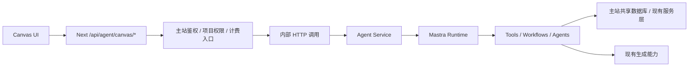

# 设计文档：Canvas Agent 同仓双服务部署

## 上下文

当前代码结构已经天然分成两块：

- `src/app`：主站、鉴权、业务 API、消息落库、项目读写
- `src/mastra`：Mastra runtime、agents、workflows、tools、memory、observability

但运行方式仍然是：

1. 主站收到 `/api/agent/canvas/message`
2. API route 直接在主站进程内加载 `src/mastra`
3. Mastra workflow 在 Next 进程内执行

这样会导致：

- 主站与 Agent 无法独立伸缩
- Mastra observability 无法稳定反映主站真实调用链路
- 主站与 Mastra Studio 进程之间的 DuckDB / trace 观测互相割裂
- Agent 超时、模型故障和工具错误会直接污染主站进程边界

因此本次设计采用“同仓、双服务、清晰边界”的部署模型。

## 目标 / 非目标

- 目标：
  - 保持单仓开发体验，同时把主站与 Agent 拆成两个独立服务
  - 让主站通过内部 HTTP 调 Agent 服务，而不是进程内 import
  - 让 Agent 服务单独拥有 Mastra runtime、observability 和 Studio 调试能力
  - 保持现有前端调用方式和外部 API 语义尽量不变
- 非目标：
  - 不做仓库拆分
  - 不做大规模业务重写
  - 不在第一阶段引入异步任务队列
  - 不改变现有用户、项目、消息与积分系统的真相源

## 总体架构

## 决策

### 决策 1：主站保留外部 API，Agent 服务只暴露内部接口

原因：

- 前端和外部调用方不需要感知 Agent 拆分
- 用户鉴权、项目权限和计费边界仍应由主站掌控
- 避免直接把 Agent 服务暴露给公网

结论：

- 外部入口仍是主站 `/api/agent/canvas/*`
- Agent 服务只暴露内部 `/internal/canvas-agent/*`

### 决策 2：主站负责“身份与业务边界”，Agent 服务负责“推理与执行编排”

主站负责：

- 用户鉴权
- 项目 / 线程访问权限校验
- 外部请求参数校验
- 积分扣减入口与消息持久化编排
- 对前端的响应协议稳定性

Agent 服务负责：

- Mastra runtime 启动
- Agent / Workflow / Tool 执行
- prompt / scene routing / refinement / response composition
- Agent 级日志、trace、observability
- 与生成服务、项目服务的受控集成

### 决策 3：第一阶段使用同步 HTTP + 流式透传

原因：

- 改动最小
- 兼容现有 `/api/agent/canvas/message` 与 streaming 结构
- 便于先把部署边界拆开，再决定是否引入异步任务系统

结论：

- 普通请求：主站 `POST` 内部 Agent 服务并等待结果
- 流式请求：主站对 Agent 服务的流进行透传

### 决策 4：Agent 服务与主站共享业务真相源，但不共享进程内状态

原因：

- 项目、线程、消息、积分等仍应复用现有数据库与服务
- 但不应再依赖“同进程对象、DuckDB 文件、内存上下文”

结论：

- 两个服务可连接同一数据库和对象存储
- 任何上下文都通过显式请求字段传递
- 不使用进程内对象作为跨服务协议

### 决策 5：内部调用必须有服务鉴权

要求：

- 主站到 Agent 服务必须带内部服务签名或 service token
- Agent 服务必须拒绝无签名或签名错误的请求
- 不复用前端用户 token 作为服务间信任凭证

## 接口草案

建议新增内部接口：

- `POST /internal/canvas-agent/message`
- `POST /internal/canvas-agent/message/stream`
- 可选：`GET /internal/health`

请求体建议包含：

- `userId`
- `projectId`
- `threadId`
- `resourceId`
- `executionMode`
- `message`
- `skillId`
- `contextMessages`
- `references`
- `selectedNodeIds`
- `requestBaseUrl`
- `requestCookieHeader`（仅在确有必要时传递，后续应逐步收敛）

响应体应尽量复用当前 `runCanvasAgentMessageWithMastra` 结果结构，避免前端协议大改。

## 目录与运行方式建议

建议保持：

- `src/mastra/*`：Mastra 业务本体
- `src/shared/services/canvas-agent/*`：主站与 Agent 共享的 transport / handler
- `src/mastra/server/*`：挂在 Mastra Server 上的内部 API 路由与服务配置

建议新增脚本：

- `pnpm dev:web`
- `pnpm dev:agent`
- `pnpm dev:all`
- `pnpm start:agent`

## 风险 / 权衡

- 风险：主站与 Agent 服务的错误语义可能不一致
  - 缓解：定义统一错误映射与 fallback 规则
- 风险：流式转发会引入额外一跳
  - 缓解：第一阶段先保证协议兼容，再观察延迟
- 风险：现有 tools 可能隐式依赖 Next 运行时
  - 缓解：逐步把这些依赖抽到共享服务层，而不是 route 层
- 风险：本地开发会多一个进程
  - 缓解：提供 `dev:all` 和明确端口约定

## 迁移计划

1. 为 Agent 服务建立独立启动入口
2. 在不改前端协议的前提下，新增主站到 Agent 的内部 client
3. 先切普通 message 请求到远程 Agent 服务
4. 再切 stream 请求到远程透传
5. 补充服务鉴权、健康检查、超时与重试配置
6. 把本地 fallback 保留为短期回滚开关

## 待决问题

- Agent 服务是否与主站同一部署平台，还是独立容器 / 独立 Worker
- 流式接口是直接字节透传，还是包装成统一事件流
- 哪些 tools 仍需依赖主站内部 API，哪些应下沉为共享 service
